**[Explorer mes projets](#projets) · [Jouer au défi SQL](#défi-sql) · [LinkedIn](https://www.linkedin.com/in/l%C3%A9o-bugyan-278158357/) · [M’écrire](mailto:bugyan.leo@gmail.com)**

Étudiant en data science, je développe des outils Python pour nettoyer des données, en tirer des indicateurs et les rendre accessibles dans des applications métier.

## Projets

<details>
<summary><strong>01 · CRM et applications métier</strong> &nbsp;·&nbsp; Django, SQL, JavaScript</summary>

Je travaille sur des applications qui centralisent des données dispersées dans des tableurs. J’y combine modélisation relationnelle, contrôles à l’import et interfaces pour retrouver et suivre l’information.

</details>

<details>
<summary><strong>02 · Analyse et automatisation</strong> &nbsp;·&nbsp; Python, pandas, NumPy</summary>

Je développe des scripts pour nettoyer et rapprocher des données de plusieurs sources, puis produire des fichiers structurés, des statistiques descriptives et des graphiques.

</details>

<details>
<summary><strong>03 · Machine learning et vision par ordinateur</strong> &nbsp;·&nbsp; Python</summary>

J’ai travaillé sur l’extraction d’indicateurs à partir de vidéos. Pour comparer des modèles, je prépare un jeu de données commun, je vérifie les doublons et j’évalue les modèles sur le même ensemble.

</details>

## Défi SQL

**En novembre, quel canal compte le plus de clients distincts ayant payé une commande ?** Le tableau utilise des données fictives. Déplie la réponse de ton choix.

| Date | Canal | Client | Statut |
| --- | --- | --- | --- |
| 03/11 | E-mail | A | Payée |
| 05/11 | Web | B | Payée |
| 08/11 | E-mail | A | Payée |
| 14/11 | Web | C | Payée |
| 19/11 | E-mail | D | Annulée |
| 02/12 | Web | D | Payée |

<details>
<summary><strong>A.</strong> Égalité, deux clients par canal</summary>

Les deux commandes payées par e-mail viennent du même client. Il ne compte qu’une fois.

</details>

<details>
<summary><strong>B.</strong> Web, deux clients</summary>

Exact. En novembre, B et C ont payé via le Web, et A a payé par e-mail.



</details>

<details>
<summary><strong>C.</strong> Web, trois clients</summary>

Le client D a payé via le Web en décembre. Sa commande sort de la période étudiée.

</details>

<details>
<summary>Voir la requête SQL</summary>

```sql
SELECT canal, COUNT(DISTINCT client_id) AS clients
FROM commandes
WHERE statut = 'payee'
  AND date_commande >= '2026-11-01'
  AND date_commande <  '2026-12-01'
GROUP BY canal
ORDER BY clients DESC;
```

</details>

## Stack

<kbd>Python</kbd> &nbsp; <kbd>SQL</kbd> &nbsp; <kbd>pandas</kbd> &nbsp; <kbd>NumPy</kbd> &nbsp; <kbd>Django</kbd> &nbsp; <kbd>JavaScript</kbd> &nbsp; <kbd>HTML/CSS</kbd> &nbsp; <kbd>Git</kbd>

## Open source

**Wand Enhancer** · J’ai corrigé un problème de compatibilité qui empêchait le chargement d’une DLL après une mise à jour du client Windows. [Voir le correctif fusionné dans mon fork](https://github.com/LeoBgn/Wand-Enhancer/pull/1)
